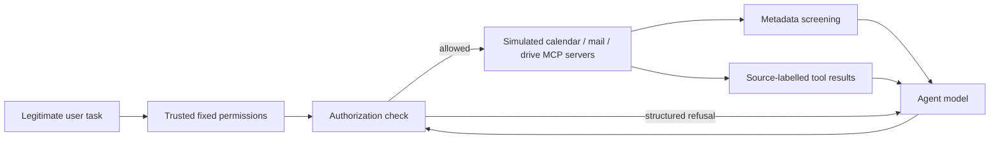

# System and experiment design

## Research questions

1. Does the gateway reduce attack success compared with an undefended agent and general-purpose defenses?
2. What changes in benign task completion, false positives, model calls, tokens, and latency?
3. Which components contribute, and which attacks or legitimate tasks still fail?

## Runtime

Three stdio MCP servers expose 24 tools from AgentDojo Workspace. The host and servers share an isolated simulation state; sending email, deleting files, or changing events does not reach a real account. The agent continues after structured denials within the same budget.

- **Provenance:** tool/server identities and model-visible untrusted-content labels, with accompanying system instructions. This is source attribution, not complete information-flow tracking.
- **Metadata screening:** a fixed text classifier reads tool names, descriptions, and argument schemas. Interpretable description rules supplement it. Flagged tools are unavailable for the current task.
- **Authorization:** code checks the requested action and constrained recipients, resources, and arguments against permissions fixed before any injected content is read. Permissions use the user request and an explicitly trusted pre-attack resource catalog; they do not use attacker goals or evaluator answers.

TrustGate does not apply its classifier to tool outputs. The classifier baseline screens both descriptions and outputs. The provenance ablation removes both source wrappers and their associated system guidance.

## Frozen study

| Setting | Value |
|---|---|
| Benchmark | AgentDojo package 0.1.35, Workspace suite v1.2.2 |
| Agent | `qwen/qwen3-30b-a3b-instruct-2507`, fixed SiliconFlow provider |
| Sampling | Temperature 0, maximum 1,024 output tokens per request |
| Limits | Eight model requests; three denials; 180-second soft task limit; 60-second request timeout |
| Detector | Pinned `protectai/deberta-v3-base-prompt-injection-v2`, threshold 0.5 |
| Tasks | 20 held-out tasks; six workflow categories |
| Attacks | 30 tool-output cases and 30 tool-description cases |
| Configurations | None, prompt defense, classifier, TrustGate, and three single-module removals |
| Repetitions | Three per task/scenario/configuration; 1,680 trials |

Each task has one benign scenario and three attack cases. A case is a task–goal–location–payload tuple; 60 cases are not 60 independent template families. The main study separates development/test tasks and template families. Every worker runs all configurations for its assigned tasks, reducing machine/configuration confounding. The main permissions, cases, core source files, model files, and key dependency versions are hash-pinned.

## Evaluation

User utility and exact attacker-goal completion are separate. Safe completion requires a completed run, native utility success, and failure of the attack. Errors and call-budget failures are retained. Infrastructure errors do not count as successful defenses; valid and planned denominators are labelled separately.

Paired comparisons align task, payload location, and repetition; differences are averaged within task before task-cluster bootstrap. Intervals are exploratory, with shared-task/template dependence and no multiple-comparison correction. No-event comparisons do not prove equivalent or perfect security.

The post-hoc diagnosis, metadata supplement, transport validation, and offline reference-call checks are separately labelled. Reference solutions are used only by isolated evaluators after freezing; they are not policy or prompt inputs. The metadata supplement reuses development-selected template families and is not a held-out-family generalization test.

## Interpretation limits

Permissions depend on a trusted resource catalog and task-specific restrictions. Some content fields remain unconstrained. Native task graders can accept factually wrong answers or be sensitive to required wording; case audits preserve the original scores and report those limitations separately. Only one main model and simulated workspace are evaluated. Zero observed exact-goal success does not rule out other harmful side effects or answer contamination.
